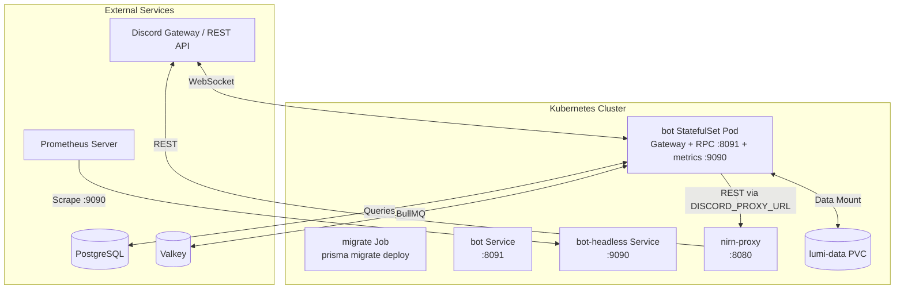

# Lumi Kubernetes Manifests

## Overview

Lumi runs as a single-process monolith: one `bot` pod owns the Discord
gateway connection, serves the dashboard RPC bridge, and runs BullMQ
scheduling in-process. No sharding manager, no separate api/scheduler
processes.

- **`bot` (StatefulSet)**: Gateway + RPC (`:8091`) + BullMQ scheduling +
  metrics (`:9090`). Single replica; the scheduler lock is held in-process.
- **`dashboard` (Deployment)**: Admin dashboard; talks to the `bot`
  service over the internal HTTP RPC bridge.
- **`nirn-proxy` (Deployment)**: Shared Discord REST rate-limit proxy
  (`DISCORD_PROXY_URL`).
- **`migrate` (Job)**: One-shot `bunx prisma migrate deploy`.

## Prerequisites

1. **Kubernetes Cluster**: Version `1.28` or higher.
2. **`kubectl` CLI**: Installed and configured with cluster admin permissions.
3. **Prometheus Operator / Server**: Configured to scrape pods annotated with `prometheus.io/scrape: "true"`.
4. **External Data Plane**: PostgreSQL and Valkey reachable from inside the
   cluster. The dashboard talks to the `bot` service over internal HTTP RPC
   (`RPC_HTTP_PORT`, default 8091).

## Manifests Reference

| Manifest File | Kind | Purpose |
|---|---|---|
| [`namespace.yaml`](./namespace.yaml) | `Namespace` | Isolated namespace for all Lumi components. |
| [`configmap.yaml`](./configmap.yaml) | `ConfigMap` | Non-sensitive environment configuration. |
| [`secret.example.yaml`](./secret.example.yaml) | `Secret` | Sensitive credential placeholders. |
| [`lumi-data-pvc.yaml`](./lumi-data-pvc.yaml) | `PersistentVolumeClaim` | Shared storage (`/app/data`). |
| [`migrate-job.yaml`](./migrate-job.yaml) | `Job` | `bunx prisma migrate deploy`. |
| [`bot-deployment.yaml`](./bot-deployment.yaml) | `StatefulSet` + `Service` | The bot plus RPC/metrics services. |
| [`dashboard-deployment.yaml`](./dashboard-deployment.yaml) | `Deployment` + `Service` | Dashboard web application (reaches `bot`). |
| [`nirn-proxy-deployment.yaml`](./nirn-proxy-deployment.yaml) | `Deployment` + `Service` | Shared Discord REST rate-limit proxy. |
| [`backup-configmap.yaml`](./backup-configmap.yaml) | `ConfigMap` | Backup scripts. |
